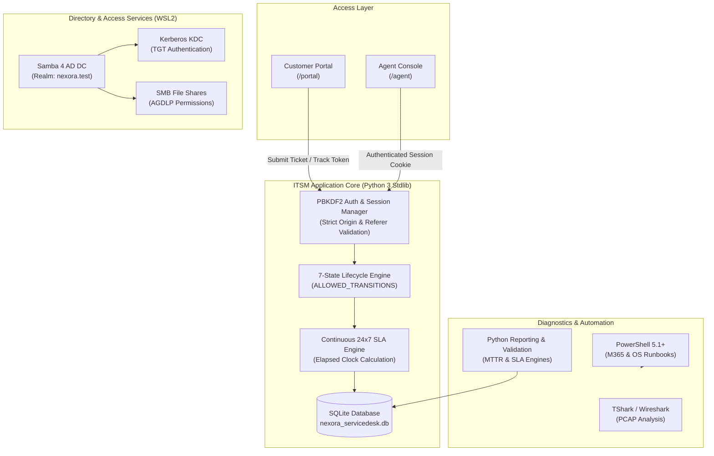

# IT Service Desk & Infrastructure Support

A comprehensive IT Service Management (ITSM) and enterprise support operations environment simulating multi-tier service desk operations, identity administration, and infrastructure troubleshooting for Nexora Technologies.

---

## Overview

This repository provides a fully functional, reproducible operations platform demonstrating technical support workflows across the ITIL v4 lifecycle:

- **Service Desk Operations:** Interactive ticketing application with queue management, customer tracking, role-based access control, and continuous SLA clock measurement.
- **Identity & Access Management:** Live Samba 4 Active Directory Domain Controller (`nexora.test`) with Kerberos authentication, AGDLP group nesting, and file share security.
- **Systems & Desktop Support:** Practical runbooks for Windows 10/11 desktop troubleshooting, print spooler recovery, performance triage, and Microsoft 365 client diagnostics.
- **Network Diagnostics & Reference Design:** Protocol inspection using packet captures with TShark display filters alongside syntax-verified Cisco IOS 3-VLAN running configurations.
- **ITIL Governance & Metrics:** Deterministic reporting engine calculating Mean Time to Resolve (MTTR), L1 resolution rate, SLA compliance, and automated dataset schema validation.

---

## Core Components

### 1. Service Desk Web Application (`itsm/portal/app.py`)
A self-contained web application and REST API built using the Python standard library (`http.server`) and SQLite:
- **Customer Portal (`/portal`):** Enables end-users to submit support tickets, view live updates, and post comments using a cryptographically generated 32-character `customer_access_token`.
- **Agent Console (`/agent`):** Technicians manage 10 operational queues (`all`, `unassigned`, `assigned_me`, `p1`, `p2`, `wait_customer`, `wait_vendor`, `sla_risk`, `sla_breached`, `resolved`), assign tickets, progress lifecycle states, and record confidential work notes.
- **Priority & SLA Engine:** Maps Impact (1–3) and Urgency (1–3) to Priority levels (P1–P4) with continuous 24x7 elapsed-hour resolution targets (P1: 4h, P2: 8h, P3: 72h, P4: 120h).
- **Application Security:** PBKDF2-HMAC-SHA256 password hashing with salt, `HttpOnly` and `SameSite=Strict` session cookies, Content Security Policy (CSP), Origin/Referer same-origin request validation (checking scheme, hostname, and port), and stored XSS output sanitization.

### 2. Active Directory Domain Services (`active-directory/`)
- Isolated **Samba 4 Active Directory Domain Controller** for realm `nexora.test` running in WSL2 Ubuntu via `scripts/deploy_samba_ad.py`.
- Departmental Organizational Units (`IT`, `HR`, `Finance`, `Operations`, `Engineering`, `Sales`) and domain accounts.
- Implementation of **AGDLP** (`Accounts` → `Global Groups` → `Domain Local Groups` → `Permissions`).
- Native Kerberos authentication (`kinit`/`klist`) and departmental SMB share access control (`CompanyShared`, `HR-Private`, `Finance-Private`, `IT-Admin`) with verified access-denied boundaries.

### 3. Windows & End-User Support (`windows-support/`, `microsoft-365/`)
- **15 Technical Runbooks:** Standard Operating Procedures covering BSOD triage, Print Spooler clearing, high CPU/RAM diagnosis, network adapter resets, BitLocker recovery, and malware isolation.
- **Client-Side Microsoft 365 Diagnostics:** Desktop troubleshooting procedures and automated PowerShell diagnostic script (`scripts/m365-client-diag.ps1`) inspecting Office Click-to-Run (C2R) services, Teams cache, OneDrive sync status, and cloud endpoint socket reachability.

### 4. Networking & Packet Analysis (`networking/`, `evidence/`)
- **Loopback Packet Capture & TShark Inspection:** Verified 20-frame `.pcap` capture analyzing TCP 3-way handshakes (SYN, SYN-ACK, ACK), DNS SRV record queries (`_ldap._tcp.nexora.test`), DNS NXDOMAIN responses, and HTTP transactions.
- **Cisco 3-VLAN Reference Design:** Syntax-accurate running configurations for Cisco 2911 router (Router-on-a-Stick sub-interfaces) and Catalyst 2960 switch for VLAN 10 (Corporate Users), VLAN 20 (Server Farm), and VLAN 99 (Management).

### 5. Reporting Engine & ITIL Governance (`reporting/`, `itil-processes/`)
- **Metrics Calculation Engine (`reporting/report-generator.py`):**
  - **Mean Time to Resolve (MTTR):** 15.75 hours across resolved incidents.
  - **L1 Resolution Rate (Non-Escalated):** 85.0% (17 of 20 incidents resolved without tier escalation).
  - **Resolved-Ticket SLA Attainment:** 100.0% (17 of 17 resolved tickets met their target).
  - **Portfolio Snapshot SLA Attainment:** 85.0% (17 of 20 total incidents compliant, accounting for 3 overdue open incidents).
- **Data Validation (`scripts/validate-data.py`):** Enforces schema, chronology, and relational consistency across incidents, service requests, problem records, changes, and asset inventories.

---

## Technical Architecture



---

## Technologies Used

- **Application & Scripting:** Python 3 (standard library: `http.server`, `sqlite3`, `csv`, `json`, `hashlib`, `urllib`), PowerShell 5.1+, Bash
- **Operating Systems & Virtualization:** Windows 11 host, Ubuntu Linux under WSL2
- **Directory & Network Services:** Samba 4 (Active Directory Domain Controller, Kerberos KDC, SMB/CIFS, DNS)
- **Protocol Analysis & Networking:** `tcpdump`, `tshark` (Wireshark CLI), Cisco IOS syntax
- **Testing & Quality Assurance:** Python `unittest`, Playwright (headless browser UI / XSS verification gate)

---

## Getting Started

### Prerequisites
- Python 3.10+ (core portal, reports, and validation require zero external pip packages).
- Optional test dependencies: `pip install -r requirements-test.txt` and `python -m playwright install chromium` (for browser UI test in Module 14).

### 1. Launch the Service Desk Web Application
```powershell
python itsm/portal/app.py
```
- **Customer Portal:** `http://127.0.0.1:8080/portal`
- **Agent Console:** `http://127.0.0.1:8080/agent`

On first run, the system generates secure bootstrap credentials for the L1 lead agent (`alex.chen`) and saves them to `.local_credentials.json` (protected with restricted NTFS ACLs on Windows and mode 0600 on Linux, git-ignored). Retrieve the generated password to log in:
```powershell
# PowerShell: Inspect local credentials
Get-Content .local_credentials.json
```

### 2. Validate Dataset Schemas & Integrity
```powershell
python scripts/validate-data.py
```
Validates all CSV registers (incidents, service requests, problem records, change management, asset inventory) for required headers, valid timestamps, priority mappings, and relational foreign keys.

### 3. Generate Service Desk Metric Reports
```powershell
# Execute unit test suite (13 passing tests)
python -m unittest discover -s reporting/tests -v

# Generate fresh text and JSON metric reports to reporting/reports/
python reporting/report-generator.py --save all
```

### 4. Run the Full Service Desk Automated Test Suite
```powershell
python scripts/test_service_desk_platform.py
```
Executes 17 comprehensive test modules verifying authentication, API authorization, complete origin validation (scheme, hostname, port), XSS mitigation, state transitions, SLA clock continuity on reopening, queue filtering, and database credential migration.

### 5. Deploy & Verify Active Directory in WSL2
```powershell
# Standard deployment and AGDLP verification
python scripts/deploy_samba_ad.py

# Credential rotation for Administrator and all domain accounts
python scripts/deploy_samba_ad.py --rotate-credentials
```

---

## Project Structure

```text
enterprise-it-service-desk-lab/
├── itsm/                    # ITSM platform documentation & local portal code
│   └── portal/              # Python Service Desk Web App (Customer & Agent portals)
├── active-directory/        # Active Directory architecture, user lifecycle, and AGDLP policies
├── networking/              # Network fundamentals, troubleshooting, and Cisco IOS configs
├── windows-support/         # Windows 10/11 troubleshooting guides and 15 support runbooks
├── microsoft-365/           # Client-side troubleshooting guides and diagnostic script
├── incidents/               # Canonical CSV datasets: incidents, requests, problems, changes
├── knowledge-base/          # Standardized KB articles (Windows, Network, M365, User Access)
├── asset-management/        # Hardware/software inventory (25 assets) and ITAM guide
├── operations/              # Daily checklists, shift handover SOPs, and support scenarios
├── itil-processes/          # ITIL v4 incident, problem, change, and continuous SLA policies
├── reporting/               # Python reporting engine, summary reports, and unit tests
├── evidence/                # Verifiable artifacts: TShark pcap analysis, Samba AD logs
├── docs/                    # Architecture, environment setup, and technical walkthrough
└── scripts/                 # Platform test suite, Samba deployment, and data validators
```

---

## Verification & Automated Test Results

| Test Target | Command | Verification Scope | Status |
|-------------|---------|---------------------|--------|
| **Data Registers** | `python scripts/validate-data.py` | Validates 5 CSV registers, schemas, and relational links | **5/5 PASS** |
| **Reporting Unit Tests** | `python -m unittest discover -s reporting/tests -v` | Unit tests for MTTR, SLA math, and edge cases | **13/13 PASS** |
| **Service Desk Platform** | `python scripts/test_service_desk_platform.py` | 17 integration tests: auth, XSS, CSRF/origin, SLA clock, queues, migration | **17/17 PASS** |
| **Active Directory & AGDLP** | `python scripts/deploy_samba_ad.py` | Kerberos KDC, AGDLP nesting, DNS hygiene, SMB share access | **5/5 PASS** |
| **Packet Capture Analysis** | `tshark -r evidence/packet-captures/...` | TCP handshakes, DNS SRV resolution, HTTP stream validation | **VERIFIED** |

---

## Project Scope & Technical Boundaries

For complete details on implemented features versus reference architecture documentation, consult [docs/project-scope.md](docs/project-scope.md) and [docs/project-walkthrough.md](docs/project-walkthrough.md):
- **Implemented Services:** Interactive Python service desk web application, SQLite database, Samba 4 AD DC in WSL2, automated metrics reporting engine, and data validation scripts.
- **Reference Blueprints:** ServiceNow and Jira Service Management runbooks, Cisco IOS 3-VLAN configuration drafts, and client-side Microsoft 365 endpoint diagnostic guides.
