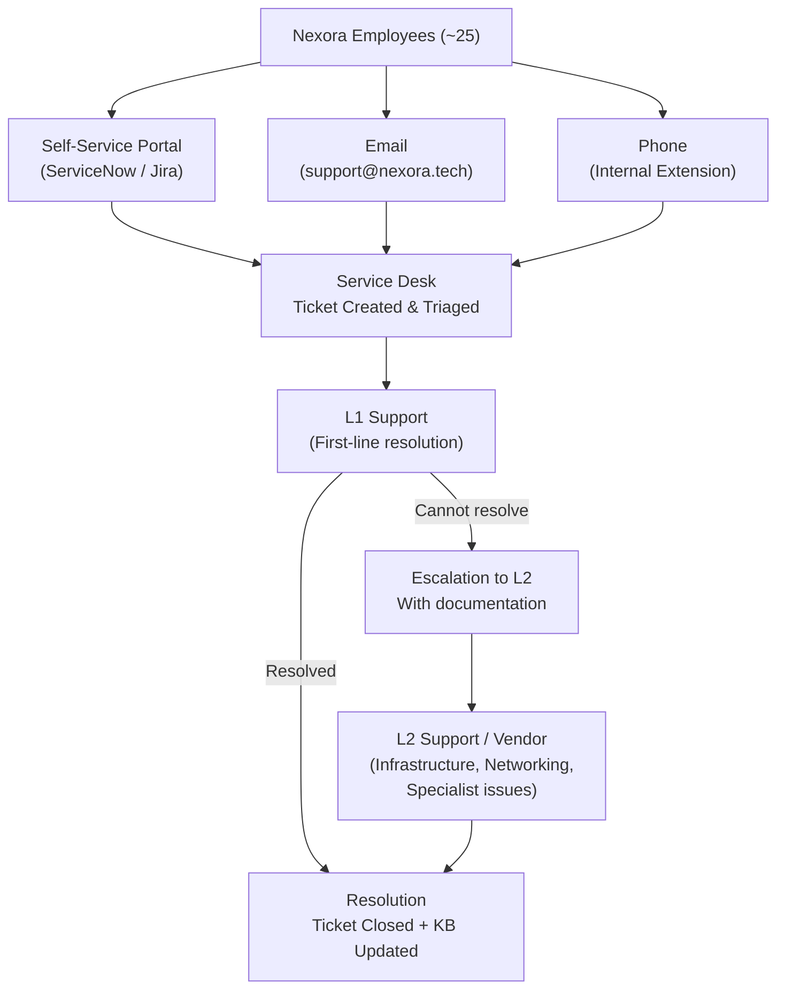
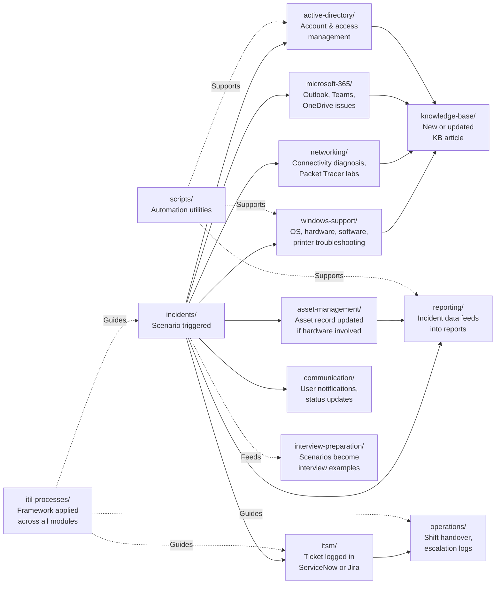
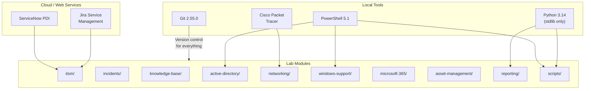

# Architecture

This document describes how the lab is structured — the support model it simulates, how the modules relate to each other, and which tools cover what.

## Support Model

Nexora Technologies uses a tiered support model. Employees contact IT through one of three channels, and requests flow through the service desk for triage and resolution.

In this lab, I'm playing the L1 role. L2 exists in the model but is represented as an escalation endpoint — when a scenario is beyond L1 scope, I document the escalation handoff rather than pretending to resolve something I wouldn't handle in a real job.

See [support-model.md](support-model.md) for the full details on how the support tiers work at Nexora.

## Module Relationships

The modules aren't isolated — they connect the way real support workflows do. An incident scenario might involve logging a ticket in ServiceNow, running Windows troubleshooting, updating the asset register, and writing a KB article.

The key insight: **incidents are the center of gravity**. Almost everything flows from or into a support incident. That's why the `incidents/` module connects to nearly everything else.

## Tool Landscape

Different modules use different tools. Here's what covers what:

### Tool Selection Summary

| Need | Tool | Rationale |
|------|------|-----------|
| Ticket management | ServiceNow PDI + Jira SM | Industry standard platforms, both free for learning |
| Network simulation | Cisco Packet Tracer | Free, widely used in CCNA training, good enough for L1 concepts |
| Windows admin | PowerShell 5.1 | Built into every Windows machine, essential IT support skill |
| Reporting & data | Python 3.14 (stdlib) | csv + json modules handle everything; no external dependencies |
| Version control | Git 2.55.0 | Track all changes, demonstrate progression |
| Documentation | Markdown files | Plain text, diffs well, renders on GitHub |

Full rationale for each choice is in [design-decisions.md](design-decisions.md).
