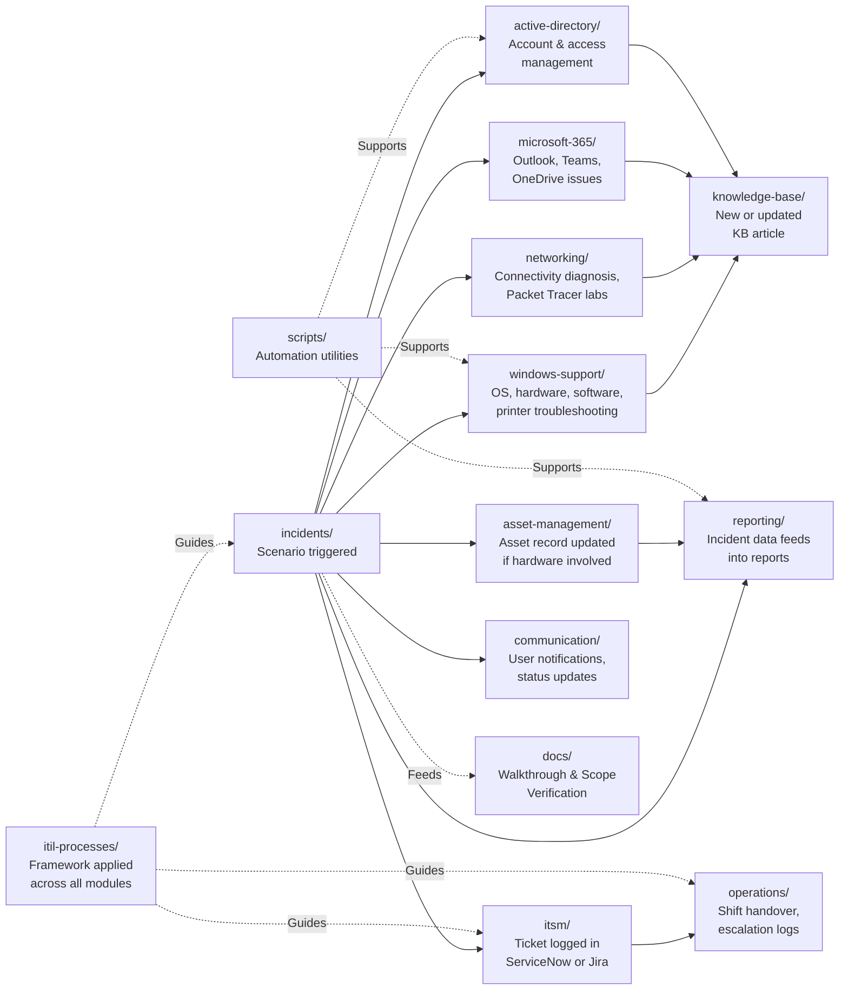
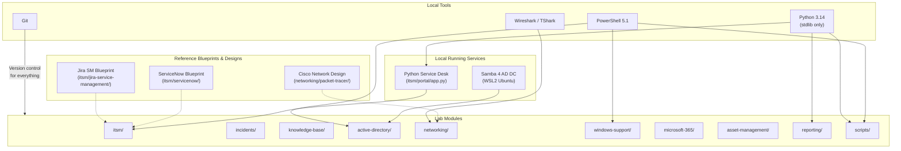

# Architecture

This document describes how the lab is structured — the support model it simulates, how the modules relate to each other, and which tools cover what.

## Support Model

Nexora Technologies uses a tiered support model. Employees contact IT through one of three channels, and requests flow through the service desk for triage and resolution.

In this lab, I'm playing the L1 role. L2 exists in the model but is represented as an escalation endpoint — when a scenario is beyond L1 scope, I document the escalation handoff rather than pretending to resolve something I wouldn't handle in a real job.

See [support-model.md](support-model.md) for the full details on how the support tiers work at Nexora.

## Module Relationships

The modules aren't isolated — they connect the way real support workflows do. An incident scenario might involve logging a ticket in ServiceNow, running Windows troubleshooting, updating the asset register, and writing a KB article.

The key insight: **incidents are the center of gravity**. Almost everything flows from or into a support incident. That's why the `incidents/` module connects to nearly everything else.

## Tool Landscape

Different modules use different tools. Here's what covers what:

### Tool Selection Summary

| Need | Tool | Implementation & Rationale |
|------|------|----------------------------|
| Interactive Service Desk | Python stdlib (`http.server` + `sqlite3`) | Real local interactive web portal at `localhost:8080` with queues, agent console, and customer tracking. Zero external dependencies. |
| Enterprise ITSM Design | ServiceNow & Jira SM Runbooks | Documented reference blueprints, field dictionaries, SLA definitions, and configuration runbooks in `itsm/`. |
| Directory Services | Samba 4 AD DC (WSL2 Ubuntu) | Real local Active Directory domain controller (`nexora.test`) providing LDAP, Kerberos, AGDLP group nesting, and SMB share testing without heavy VM resource usage. |
| Network Analysis | Wireshark / TShark | Packet analysis using a 20-frame loopback `.pcap` capture and TShark display filters. |
| Network Design | Cisco IOS Running Configs | Syntax-accurate Cisco 2911 router and 2960 switch configuration drafts and topology documentation in `networking/packet-tracer/`. |
| Windows Admin | PowerShell 5.1 | Built into Windows; runbooks for desktop troubleshooting, client diagnostics, and automated audits. |
| Reporting & Validation | Python 3.14 (stdlib) | Native CSV and JSON processing for MTTR, SLA calculations, and schema verification; 13/13 passing unit tests. |
| Version Control | Git | Tracking all iterations, code, and documentation cleanly. |
| Documentation | Markdown files | Plain text, clean diffs, and readable directly on GitHub. |

Full rationale for each choice is in [design-decisions.md](design-decisions.md).
