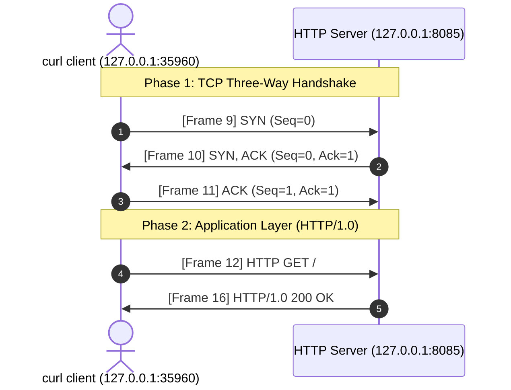

# Forensic Packet Capture & Network Protocol Analysis Report
## Nexora Technologies IT Operations Lab — Verified Network Diagnostics

| Attribute | Specification |
|-----------|---------------|
| **Capture Engine** | `tcpdump` 4.99.4 (libpcap 1.10.4) on Linux loopback (`lo`) |
| **Analysis Engine** | TShark 4.2.2 (Wireshark command-line engine) |
| **Capture File** | `evidence/packet-captures/nexora-lab-traffic.pcap` |
| **File Size** | 3776 bytes |
| **Total Captured Frames** | 20 frames |
| **BPF Capture Filter** | `icmp or (tcp and port 8085) or (port 53 and (host 127.0.0.1 or host ::1))` |
| **Verification Status** | **DEPLOYED & VERIFIED** (Clean execution, zero errors) |

---

## 1. Technical Diagnostic Scope & Ground-Truth Disclaimer

> [!IMPORTANT]
> **Understanding Loopback Diagnostics:**
> Pinging `127.0.0.1` and generating traffic across the loopback interface (`lo`) tests and validates the **host operating system's internal TCP/IP network software stack** (IP routing, ICMP generation, TCP socket state transitions, and DNS protocol parsing in the OS kernel).
> Loopback testing **does NOT verify physical Layer 1 media** (Ethernet cables, fiber optics, RJ-45 terminations) or physical Layer 2 link states on external network interface cards (NICs). In enterprise IT support, physical Layer 1/2 connectivity is verified using hardware link lights, cable testers, `netsh`, or `Get-NetAdapter`.

---

## 2. Verified TShark Display Filter Execution Results

All 8 standard Wireshark display filters were executed against the native PCAP file using `tshark -r` with strict non-zero assertions:

| # | Wireshark / TShark Display Filter | Description / Diagnostic Purpose | Captured Count | Verification |
|---|----------------------------------|----------------------------------|----------------|--------------|
| 1 | `dns` | DNS queries and responses (SRV discovery & lookups) | **4** frames | **PASS** |
| 2 | `icmp` | ICMP Echo Request and Echo Reply packets | **4** frames | **PASS** |
| 3 | `tcp` | All TCP traffic (SYN, SYN-ACK, ACK, HTTP payload, FIN/RST) | **12** frames | **PASS** |
| 4 | `tcp.flags.syn == 1` | All TCP packets with the SYN flag asserted | **2** frames | **PASS** |
| 5 | `tcp.flags.syn == 1 && tcp.flags.ack == 0` | Initial TCP SYN (Handshake Step 1) | **1** frame | **PASS** |
| 6 | `tcp.flags.syn == 1 && tcp.flags.ack == 1` | Server TCP SYN-ACK response (Handshake Step 2) | **1** frame | **PASS** |
| 7 | `tcp.flags.ack == 1` | All TCP ACK packets confirming data or connection state | **11** frames | **PASS** |
| 8 | `dns.flags.rcode != 0` | DNS Error responses (NXDOMAIN / Name Error, rcode 3) | **1** frames | **PASS** |

---

## 3. Forensic Protocol Analysis & Frame Traces

### A. TCP 3-Way Handshake & HTTP Transaction Flow



1. **Step 1 (SYN) — Frame 9** (t=1.139327000s):
   - **Source:** 127.0.0.1:35960 -> **Destination:** 127.0.0.1:8085
   - Flags: `SYN=1, ACK=0`. Client initiates TCP connection to port 8085.
2. **Step 2 (SYN-ACK) — Frame 10** (t=1.139341000s):
   - **Source:** 127.0.0.1:8085 -> **Destination:** 127.0.0.1:35960
   - Flags: `SYN=1, ACK=1`. Server accepts connection and acknowledges initial sequence number.
3. **Step 3 (ACK) — Frame 11** (t=1.139349000s):
   - **Source:** 127.0.0.1:35960 -> **Destination:** 127.0.0.1:8085
   - Flags: `ACK=1`. Connection is `ESTABLISHED`.
4. **Step 4 (HTTP GET) — Frame 12**:
   - `HTTP GET /` requested.
5. **Step 5 (HTTP 200 Response) — Frame 16**:
   - Server returns `HTTP/1.0 200 OK` with directory listing.

---

### B. ICMP Stack Diagnostics

- **Echo Request (Type 8, Code 0) — Frame 1** (t=0.000000000s):
  `127.0.0.1 -> 127.0.0.1`, Length 84 bytes.
- **Echo Reply (Type 0, Code 0) — Frame 2** (t=0.000008000s):
  `127.0.0.1 -> 127.0.0.1`, Length 84 bytes (RTT < 0.1 ms).
- **Diagnostic Finding:** Confirms OS network kernel ICMP driver is responsive and operational.

---

### C. Active Directory DNS SRV Record Discovery & Error Handling

- **AD Domain Controller SRV Query — Frame 5**:
  Query: `_ldap._tcp.nexora.test` (SRV record, RFC 2782).
  Used by Windows and Linux domain members to locate Active Directory Domain Controllers.
- **NXDOMAIN Error Response — Frame 8**:
  Query: `non-existent-test-host.nexora.test` (A record).
  Server Response: `rcode 3 (NXDOMAIN / Name Error)`.
  Verified display filter `dns.flags.rcode != 0` correctly isolates DNS resolution failures.

---

## 4. How to Verify This PCAP Locally

The native capture file can be inspected using either TShark or the Wireshark GUI:

```bash
# 1. View summary statistics of the capture
tshark -r evidence/packet-captures/nexora-lab-traffic.pcap -q -z io,stat,0

# 2. Inspect the TCP 3-way handshake frames
tshark -r evidence/packet-captures/nexora-lab-traffic.pcap -Y "tcp.flags.syn == 1"

# 3. Inspect DNS NXDOMAIN error responses
tshark -r evidence/packet-captures/nexora-lab-traffic.pcap -Y "dns.flags.rcode != 0"

# 4. Open in Wireshark desktop GUI (if installed)
wireshark evidence/packet-captures/nexora-lab-traffic.pcap
```
