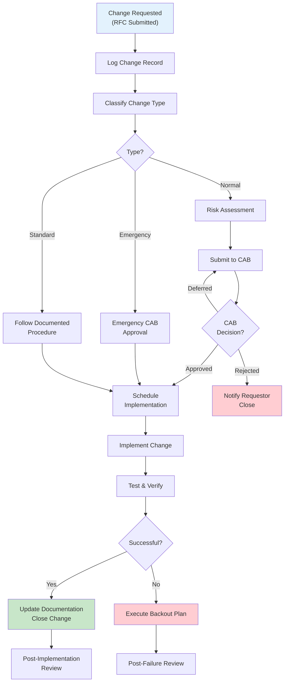

# Change Management

> **Nexora Technologies — IT Service Desk**
> Change management process for controlled modification of IT infrastructure and services.

## Purpose

Every change to IT infrastructure carries risk. Change management exists to make sure changes are planned, assessed, approved, implemented, and reviewed — so they don't create more incidents than they solve.

## What Counts as a Change?

A change is any addition, modification, or removal of anything that could affect IT services.

**Examples:**
- Installing a new switch on the network
- Upgrading firmware on a firewall
- Deploying a new version of a business application
- Modifying Active Directory group policies
- Adding a new VLAN
- Changing DNS records
- Patching servers

**Not changes (these are service requests):**
- Installing standard software on one user's laptop (pre-approved, in the catalog)
- Resetting a password
- Adding a user to a distribution list

The distinction: a service request follows a pre-approved, repeatable procedure with negligible risk. A change modifies infrastructure or services and needs assessment.

## Change Types

### Standard Change

Pre-approved, low-risk, follows a documented procedure. No CAB review needed each time because it was approved as a class of changes.

| Attribute | Detail |
|-----------|--------|
| Risk | Low |
| Approval | Pre-approved (one-time approval for the procedure) |
| Examples | Monthly Windows patches (per patch schedule), adding a user to a standard group, standard printer deployment |
| Documentation | Procedure document must exist; change record still logged for audit trail |
| Implementation | Follow the procedure, document the result |

### Normal Change

Planned change that requires assessment and approval. Most changes at Nexora fall here.

| Attribute | Detail |
|-----------|--------|
| Risk | Low to High (assessed per change) |
| Approval | CAB or delegated approver |
| Examples | Network topology change, server migration, new application deployment, firewall rule change |
| Lead Time | Minimum 5 business days for planning and review |
| Documentation | Full change record: description, risk assessment, backout plan, test plan |

### Emergency Change

Unplanned change to resolve a P1/P2 incident or critical security vulnerability. Skips the normal approval workflow but gets retrospective review.

| Attribute | Detail |
|-----------|--------|
| Risk | Often high (done under pressure with less planning) |
| Approval | Emergency CAB (IT Manager + Senior Engineer) — can be verbal, documented after |
| Examples | Emergency security patch for actively exploited vulnerability, restoring a failed server from backup, emergency DNS change during outage |
| Documentation | Change record completed retrospectively within 1 business day |
| Review | Mandatory post-implementation review by CAB |

## Change Advisory Board (CAB)

The CAB reviews normal changes before they're approved for implementation.

### Nexora CAB Composition

| Role | Person (Fictional) | Responsibility |
|------|-------------------|----------------|
| CAB Chair | Ramesh Iyer (IT Manager) | Final approval, conflict resolution |
| Senior Systems Engineer | Deepak Nair | Technical risk assessment |
| Network Engineer | Arjun Mehta | Network impact assessment |
| Service Desk Lead | Ananya Rao | User impact assessment |
| Business Representative | Rotating department head | Business impact assessment |

### CAB Meeting

- **Frequency:** Weekly (Friday 14:00 IST), or ad-hoc for urgent normals
- **Agenda:** Review submitted change requests for the following week
- **Each change presenter must cover:** What, why, when, who's affected, risk level, backout plan
- **Outcomes:** Approved / Approved with conditions / Rejected / Deferred

## Risk Assessment

Every normal and emergency change gets a risk assessment.

### Risk Matrix

| Factor | Low (1) | Medium (2) | High (3) |
|--------|---------|------------|----------|
| **Impact of failure** | Single user/non-critical service | Department/degraded critical service | Organization-wide/critical service down |
| **Complexity** | Simple, done many times | Moderate, some unknowns | Complex, first time, multiple dependencies |
| **Reversibility** | Easily reversed, backout tested | Reversible with effort | Difficult or impossible to reverse |
| **Testing** | Fully tested in lab/staging | Partially tested | Cannot test before production |

**Risk Score = Sum of factors (4-12)**

| Score | Risk Level | Approval Path |
|-------|-----------|---------------|
| 4-6 | Low | Service Desk Lead can approve |
| 7-9 | Medium | CAB approval required |
| 10-12 | High | CAB + IT Manager + stakeholder sign-off |

## Change Workflow



## Change Record Fields

| Field | Description | Example |
|-------|-------------|---------|
| Change ID | Auto-generated | CHG0004 |
| Title | Clear description | "Upgrade core switch firmware to v4.2.1" |
| Type | Standard / Normal / Emergency | Normal |
| Category | Infrastructure / Application / Network / Security | Network |
| Priority | Low / Medium / High / Critical | Medium |
| Requested By | Person or team requesting | Arjun Mehta |
| Description | What's being changed and why | "Current firmware v4.0.3 has known VLAN tagging bug affecting 2nd floor. Upgrade to v4.2.1 per vendor advisory." |
| Risk Assessment | Score and narrative | Score: 8 (Medium). Core switch serves all 2nd floor traffic. |
| Impact | Who/what is affected | All 2nd floor users (~8 people), 15 min downtime |
| Backout Plan | How to undo if it fails | "Reload previous firmware image from TFTP. Estimated rollback: 10 min." |
| Test Plan | How to verify success | "Ping test all 2nd floor VLANs, verify trunk status, check VLAN assignments" |
| Scheduled Date | When it will happen | 2024-11-23 22:00 IST (Saturday maintenance window) |
| Implementer | Who does the work | Arjun Mehta |
| Approver | Who approved | Ramesh Iyer (CAB) |
| Status | Draft / Submitted / Approved / Scheduled / Implementing / Completed / Failed / Cancelled | Approved |
| Result | Post-implementation outcome | Successful / Failed / Partial |

## Backout Planning

Every change must have a backout plan before it's approved. "We'll figure it out" is not a backout plan.

### Backout Plan Requirements

1. **Specific steps** to reverse the change — not "restore from backup" but which backup, where it is, what command to run
2. **Time estimate** for the backout — if rollback takes 2 hours and the maintenance window is 2 hours, you have a problem
3. **Success criteria for backout** — how do you know the rollback worked?
4. **Decision point** — when do you call it and start the backout? (e.g., "If firmware upload fails or switch doesn't boot within 5 minutes of reload, execute backout")
5. **Communication** — who needs to know if you're rolling back?

### Backout Example

```
Change: CHG0004 — Upgrade core switch firmware
Decision Point: If switch does not boot with new firmware within 5 minutes 
                of reload, OR if VLAN assignments are missing post-upgrade.

Backout Steps:
1. Console into switch (already connected during change)
2. Boot to rommon: `boot flash:firmware-v4.0.3.bin`
3. Verify boot with `show version`
4. Verify VLANs with `show vlan brief`
5. Ping test gateway from each VLAN
6. If all pass, notify CAB of rollback

Estimated Backout Time: 10 minutes
```

## Maintenance Windows

| Window | Time | Used For |
|--------|------|----------|
| Standard | Saturday 22:00 – Sunday 02:00 IST | Network, server, infrastructure changes |
| Extended | Saturday 20:00 – Sunday 06:00 IST | Major changes (migrations, upgrades) |
| Application | Wednesday 22:00 – Thursday 00:00 IST | Application deployments |

Changes outside maintenance windows require IT Manager approval and a communication plan for affected users.

## Post-Implementation Review

Within 2 business days of implementation:

- [ ] Was the change implemented as planned?
- [ ] Were there unexpected issues?
- [ ] Did the backout plan need to be executed? If so, why?
- [ ] Were there incidents caused by the change?
- [ ] Were timelines met?
- [ ] Are documentation and configuration records updated?
- [ ] Lessons learned?

## L1's Role in Change Management

As L1, you don't typically implement changes, but you play a critical role:

1. **Awareness** — Know what changes are scheduled this week. Check the change calendar daily.
2. **Impact correlation** — When incidents come in, check if a recent change could be the cause. "Did anything change?" is the single most valuable question in troubleshooting.
3. **User communication** — You're the first point of contact when users report issues that are actually planned outages.
4. **Raise RFCs** — If you identify something that needs changing (a persistent problem, a configuration gap), submit a Request for Change.
5. **Post-change monitoring** — Watch for incidents after a change window. Early detection is better than waiting for users to call.

## Common Mistakes

- Implementing changes without a backout plan
- Skipping CAB for "small" normal changes (if it's truly low-risk, make it a standard change with a documented procedure)
- Not communicating planned downtime to affected users
- Not checking the change calendar when troubleshooting new incidents
- Emergency changes that aren't really emergencies (trying to skip the approval process)
- Not updating documentation after a change (network diagrams, CMDB, runbooks)
