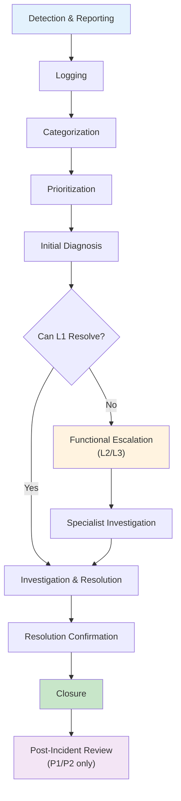

# Incident Management Process

> **Nexora Technologies — IT Service Desk**
> ITIL-aligned incident management process for L1 support operations.

## Purpose

Restore normal service operation as quickly as possible while minimizing business impact. An incident is any unplanned interruption to an IT service or reduction in quality of an IT service.

## Incident vs Other Record Types

| Scenario | Record Type |
|----------|-------------|
| "My laptop won't boot" | Incident |
| "I need a new monitor" | Service Request |
| "This same printer jam happens every week" | Problem |
| "Upgrade the VPN concentrator firmware" | Change |

If you're not sure, log it as an incident. It can be reclassified later. Under-logging is worse than mis-categorizing.

## Incident Lifecycle

## Phase Details

### 1. Detection & Reporting

Incidents enter the service desk through:

- **Self-service portal** — User submits a ticket through the ITSM portal (preferred)
- **Email** — `itsupport@nexora.test` creates a ticket automatically
- **Phone** — L1 analyst logs the ticket on behalf of the caller
- **Monitoring alerts** — Automated alerts from infrastructure monitoring (Nagios, UptimeRobot, etc.)
- **Walk-up** — User comes to the IT desk; analyst logs the ticket during the conversation

Regardless of channel, every incident gets a ticket. No ticket, no work.

### 2. Logging

Every incident record must capture at minimum:

| Field | Description | Example |
|-------|-------------|---------|
| Incident ID | Auto-generated | INC0021 |
| Reported By | Name of the person reporting | Priya Sharma |
| Contact Info | Phone/email | priya.sharma@nexora.test |
| Department | Business unit | Finance |
| Reported Date/Time | When the call/email came in | 2024-11-12 09:15 IST |
| Description | User's own words, verbatim | "My Outlook keeps crashing when I try to open attachments" |
| Category | See categorization below | Software |
| Subcategory | Specific area | Email/Outlook |
| Affected Asset | Asset tag if applicable | NXT-AST-007 |

**Documentation standard:** Write what the user actually said, not your interpretation. "User reports Outlook crashes on attachment open" is good. "Email client has a bug" is bad — that's your diagnosis, not their report.

### 3. Categorization

Use the standard category tree:

| Category | Subcategories |
|----------|---------------|
| Hardware | Laptop, Desktop, Monitor, Printer, Peripheral, Docking Station |
| Software | OS, Office Suite, Email/Outlook, Browser, Line-of-Business App, Antivirus |
| Network | Connectivity, Wi-Fi, VPN, DNS, Slow Performance |
| Access/Account | Password Reset, Account Lockout, Permission Request, New Account |
| Printing | Print Queue, Driver, Paper Jam, Toner |
| Email | Outlook, Calendar, Shared Mailbox, Distribution List |

Pick the category that matches the **symptom**, not the root cause. If a user can't print because of a network issue, log it as Printing initially. You can reclassify after diagnosis.

### 4. Prioritization

Priority is derived from Impact × Urgency, not chosen at random.

**Impact** — How many users/services affected:

| Level | Definition | Example |
|-------|-----------|---------|
| 1 - High | Entire department or business-critical service down | Email server down, ERP inaccessible |
| 2 - Medium | Multiple users or degraded service | Shared printer down, slow network for a floor |
| 3 - Low | Single user, workaround available | One user's second monitor not detected |

**Urgency** — How time-sensitive:

| Level | Definition | Example |
|-------|-----------|---------|
| 1 - High | Work completely blocked, no workaround | Cannot log in at all |
| 2 - Medium | Work impaired but can continue partially | VPN drops every 30min, have to reconnect |
| 3 - Low | Inconvenience, workaround exists | Desktop wallpaper stuck on default |

**Priority Matrix:**

| | Urgency 1 (High) | Urgency 2 (Medium) | Urgency 3 (Low) |
|---|---|---|---|
| **Impact 1 (High)** | P1 - Critical | P2 - High | P3 - Medium |
| **Impact 2 (Medium)** | P2 - High | P3 - Medium | P4 - Low |
| **Impact 3 (Low)** | P3 - Medium | P4 - Low | P4 - Low |

**SLA targets per priority** — see [sla-policy.md](sla-policy.md) for the full policy:

| Priority | Response | Resolution |
|----------|----------|------------|
| P1 | 15 minutes | 4 hours |
| P2 | 1 hour | 8 hours |
| P3 | 4 hours | 3 business days |
| P4 | 1 business day | 5 business days |

### 5. Initial Diagnosis

L1 runs through standard checks before escalating:

1. Check the knowledge base for known solutions
2. Check if there's a known error or ongoing problem record
3. Ask the user: When did it start? What changed? Has it worked before? Does a reboot help?
4. Try standard fixes: restart application, clear cache, check cables, verify network
5. Check if other users in the same department/location have the same issue (→ potential major incident)

**Time-box your diagnosis.** If you haven't made progress in 30 minutes on a P1 or 60 minutes on a P2, escalate. Don't sit on it.

### 6. Investigation & Resolution

If L1 can resolve:

- Apply the fix
- Document exactly what you did and why it worked
- Document the root cause if known
- Update the ticket with resolution notes

Resolution notes should be specific enough that another analyst could repeat them. "Fixed the issue" is not a resolution note. "Cleared Outlook cache at `%localappdata%\Microsoft\Outlook`, restarted Outlook, attachments now open normally" is.

### 7. Escalation

See [escalation-matrix.md](escalation-matrix.md) for the full matrix. Key rules:

- **Functional escalation** (L1→L2→L3): When you lack the skills or access to resolve
- **Hierarchical escalation** (to management): When SLAs are at risk, or the impact is larger than initially assessed
- **When escalating, include:**
  - Everything you've already tried (so they don't repeat it)
  - Diagnostic data collected
  - Impact assessment
  - Your best guess at the root cause

### 8. Resolution Confirmation

Before closing, confirm with the user:

- "Is the issue resolved to your satisfaction?"
- Wait for explicit confirmation — don't auto-close
- If the user doesn't respond within 3 business days, the ticket moves to Resolved and auto-closes after 2 more days

### 9. Closure

A closed ticket should contain:

- [ ] Accurate category and subcategory
- [ ] Correct priority assignment
- [ ] Complete resolution notes
- [ ] Root cause identified (if possible)
- [ ] Time entries logged
- [ ] User confirmation of resolution
- [ ] Knowledge article created/updated (if it was a new fix)

### 10. Post-Incident Review (P1 and P2 Only)

For P1 and P2 incidents, within 2 business days of closure:

- What happened and when (timeline)
- What was the root cause
- What was the fix
- Could we have detected it faster
- What changes would prevent recurrence (→ feed into problem management)

## Roles

| Role | Responsibilities |
|------|-----------------|
| **L1 Analyst** | First contact, logging, categorization, initial diagnosis, known-fix resolution, escalation |
| **L2 Specialist** | Deep diagnosis, application/infrastructure support, workaround development |
| **L3 / Vendor** | Code fixes, firmware patches, architecture changes |
| **Incident Manager** | Owns the process, manages major incidents, ensures SLA compliance |
| **Service Desk Lead** | Queue management, workload balancing, quality review |

## L1 Analyst Responsibilities (What You Own)

As L1, you are the face of IT to the business. Your specific duties:

1. **Answer every contact** — portal, email, phone, walk-up. No cherry-picking.
2. **Log everything** — If it's not in a ticket, it didn't happen.
3. **Categorize and prioritize correctly** — Use the matrix, not your gut.
4. **Attempt resolution** — Knowledge base, standard fixes, documented procedures.
5. **Escalate when stuck** — Not a failure, it's a process step. But document what you tried.
6. **Keep the user informed** — Update them when you start work, when you escalate, and when it's fixed.
7. **Close the loop** — Confirm resolution, close the ticket, update knowledge base.

## Major Incident Process

A major incident is any P1 that affects multiple users or a critical business service. Additional steps:

1. Declare major incident — Notify the Incident Manager immediately
2. Open a bridge call / Teams channel for coordinated troubleshooting
3. Assign a dedicated communicator — Someone sends status updates every 30 minutes
4. All-hands troubleshooting — Pull in L2/L3 as needed, no waiting for normal escalation queue
5. Status page update — Notify affected users through the portal
6. Resolution and detailed post-incident review within 24 hours

## Key Metrics

| Metric | What It Measures | Target |
|--------|-----------------|--------|
| First Contact Resolution (FCR) | % resolved at L1 without escalation | ≥70% |
| Mean Time to Resolve (MTTR) | Average resolution time by priority | Within SLA |
| SLA Compliance | % of tickets resolved within SLA | ≥95% |
| Reopen Rate | % of tickets reopened after closure | ≤5% |
| Customer Satisfaction (CSAT) | Post-resolution survey score | ≥4.0/5.0 |

## Common Mistakes

- Closing tickets without user confirmation
- Leaving priority at default instead of assessing Impact × Urgency
- Writing vague resolution notes ("fixed it", "working now")
- Not checking for related incidents (missing a pattern that should be a problem record)
- Sitting on a ticket instead of escalating when you're stuck
