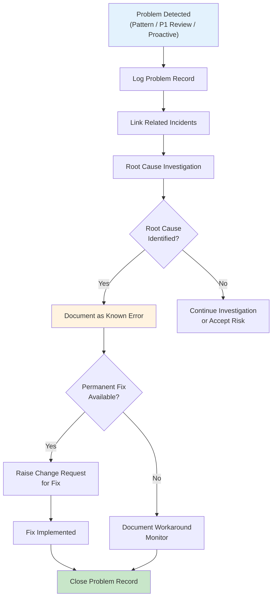

# Problem Management

> **Nexora Technologies — IT Service Desk**
> Problem management process for identifying and eliminating recurring incidents.

## What Is Problem Management?

Problem management investigates **why** incidents happen, not just how to fix them in the moment. An incident restores service. A problem removes the underlying cause so the incident doesn't happen again.

| Term | Definition | Example |
|------|-----------|---------|
| **Incident** | A single event that breaks or degrades service | "My Outlook crashed" |
| **Problem** | The underlying cause of one or more incidents | "Outlook crashes for all users with add-in X installed" |
| **Known Error** | A problem where the root cause is identified and a workaround or fix exists | "Add-in X has a memory leak; vendor patch pending; workaround: disable add-in" |
| **Workaround** | A temporary way to reduce the impact until a permanent fix is applied | "Disable the add-in via GPO" |

## Reactive vs Proactive Problem Management

### Reactive Problem Management

Triggered when you notice patterns in incidents after the fact.

**Triggers:**
- Multiple incidents with the same root cause or symptoms
- A P1/P2 incident that warrants root cause analysis
- An incident where the resolution was a workaround, not a permanent fix
- Recurring incidents from the same user, asset, or service

**Example:** Three users in Finance report Outlook crashing this week. Each was resolved by restarting Outlook. After the third one, L1 raises a problem record: "Outlook crashes — Finance department — possibly related to recent add-in deployment."

### Proactive Problem Management

Looking for problems before incidents occur.

**Activities:**
- Reviewing trend reports — Are incidents in a specific category increasing?
- Analyzing monitoring data — Is a server's disk filling up slowly?
- Reviewing vendor advisories — Is there a known vulnerability in software we use?
- Post-incident review findings — Did a P1 review reveal a systemic risk?
- Aging asset analysis — Are machines past warranty showing more hardware failures?

**Example:** Monthly review shows network incidents on the 2nd floor have doubled in three months. No single P1, but the trend is clear. Problem record raised: "Increasing network instability — 2nd floor — investigate switch and cabling."

## Problem Management Workflow



## Root Cause Analysis Techniques

### 5 Whys

Ask "why" repeatedly until you reach the fundamental cause. Simple but effective for straightforward problems.

**Example: Printer on 2nd floor keeps jamming**

1. **Why** does the printer jam? → The paper feed roller is worn.
2. **Why** is the roller worn? → The printer has processed 300,000+ pages.
3. **Why** hasn't it been serviced? → There's no preventive maintenance schedule for printers.
4. **Why** is there no PM schedule? → Printers were treated as "replace when broken" assets.
5. **Why** that policy? → Cost consideration when the fleet was 3 printers; it's now 8.

**Root cause:** No preventive maintenance process for growing printer fleet.
**Fix:** Implement quarterly printer maintenance, starting with high-volume units.

**Common pitfall:** Stopping too early. "The roller is worn" sounds like a root cause, but it's really a symptom. The real issue is the missing maintenance process.

### Fishbone (Ishikawa) Diagram

Organize potential causes into categories to ensure you don't miss anything. Good for complex problems with multiple possible causes.

Standard categories for IT problems:

```
                        ┌─── People ────────────── Training gap, incorrect procedure followed
                        │
                        ├─── Process ───────────── Missing approval step, no change window
                        │
PROBLEM ◄───────────────┼─── Technology ────────── Hardware failure, software bug, capacity
                        │
                        ├─── Environment ────────── Power, cooling, cabling, physical access
                        │
                        └─── External ──────────── Vendor outage, ISP issue, third-party API
```

**Example: VPN drops every 30 minutes for remote users**

| Category | Potential Causes |
|----------|-----------------|
| People | Users on unsupported OS versions; users not updating VPN client |
| Process | No VPN client version policy; no monitoring for session drops |
| Technology | VPN concentrator at 90% capacity; session timeout misconfiguration; ISP MTU mismatch |
| Environment | Concentrator in a rack with poor ventilation (thermal throttling) |
| External | ISP performing maintenance; home router firmware bugs |

### Timeline Analysis

For P1 incidents, reconstruct exactly what happened and when.

| Time | Event | Source |
|------|-------|--------|
| 08:30 | Backup job starts on DB server | Backup logs |
| 08:45 | DB server CPU hits 95% | Monitoring |
| 08:52 | ERP response time exceeds 10s | APM tool |
| 08:55 | First user calls: "ERP is down" | Ticket INC0015 |
| 09:10 | Backup job completes | Backup logs |
| 09:12 | ERP performance returns to normal | APM tool |

**Root cause:** Backup job consuming all I/O, starving the ERP database. **Fix:** Reschedule backups to 02:00.

### Comparative Analysis

When the same system works for some users/locations but not others, compare what's different.

| Factor | Working Users | Affected Users |
|--------|--------------|----------------|
| OS Version | Win 11 23H2 | Win 11 23H2 |
| Outlook Version | 16.0.17928 | 16.0.17928 |
| Add-ins | Standard set | Standard + "DataAnalyzer Pro" |
| Antivirus | SentinelOne 23.4 | SentinelOne 23.4 |

**Root cause:** The "DataAnalyzer Pro" add-in, deployed to Finance only.

## Linking Incidents to Problems

When a problem record exists:

1. Link all related incidents to the problem record (by Problem ID)
2. If a workaround exists, document it in the problem record and reference it from incident resolution notes
3. New incidents matching the pattern should be linked immediately — this tracks scope
4. When the problem is resolved, all linked incidents benefit from the permanent fix

**In ITSM tools:**
- ServiceNow: Incident form → Related Records → Problem field → link the PRB number
- JSM: Link issue → "is caused by" → select the problem

## Known Error Database (KEDB)

A known error is a problem where:
- Root cause has been identified
- A workaround or permanent fix is documented

The KEDB is where L1 looks first during incident diagnosis.

### KEDB Entry Template

```
Known Error ID: KE0001
Problem ID: PRB0001
Title: Outlook crashes when opening PDF attachments
Affected Service: Email
Root Cause: Conflict between Outlook add-in "DataAnalyzer Pro" v2.3 and 
            Office 365 update 17928.20114
Workaround: Disable DataAnalyzer Pro add-in (File → Options → Add-ins → 
            COM Add-ins → uncheck DataAnalyzer Pro)
Permanent Fix: Vendor patch for DataAnalyzer Pro v2.4 — ETA January 2025
Status: Workaround in place, awaiting vendor patch
Related Incidents: INC0003, INC0008, INC0012
Last Updated: 2024-11-18
```

### Using the KEDB in Practice

1. User reports Outlook crash → L1 searches KEDB for "Outlook crash"
2. Finds KE0001 → Applies workaround (disable add-in)
3. Links incident to PRB0001
4. Resolves incident with note: "Applied workaround per KE0001"
5. Total handling time: 5 minutes instead of 45

This is why maintaining the KEDB matters — it directly reduces resolution time.

## Problem Record Fields

| Field | Description |
|-------|-------------|
| Problem ID | Auto-generated (PRB0001) |
| Title | Clear, specific description of the underlying issue |
| Related Incidents | INC IDs linked to this problem |
| Category | Same taxonomy as incidents |
| Status | Open / Root Cause Identified / Known Error / Closed |
| Priority | Based on frequency and impact of related incidents |
| Root Cause | Detailed description once identified |
| Workaround | Steps to mitigate until permanent fix |
| Permanent Fix | What needs to change to eliminate the problem |
| Owner | Who is driving the investigation |
| Identified Date | When the problem was logged |
| Resolved Date | When the permanent fix was implemented |

## When L1 Should Raise a Problem Record

You don't need to be a problem manager to flag a pattern. Raise a problem record (or flag one for your lead) when:

- You see 3+ incidents with the same symptoms in a week
- A P1 or P2 is resolved with a workaround, not a permanent fix
- An incident keeps recurring for the same user or asset
- You find yourself applying the same fix repeatedly

## Metrics

| Metric | What It Measures | Target |
|--------|-----------------|--------|
| Problems identified | Number of new problem records | Trending up is good (you're finding them) |
| Incidents linked to problems | % of incidents tied to known problems | Higher = better pattern detection |
| Known errors with workarounds | % of known errors that have documented workarounds | 100% |
| Time to identify root cause | Days from problem logged to root cause found | ≤10 business days |
| Recurring incidents after fix | Incidents matching a "closed" problem | Should be 0 |
