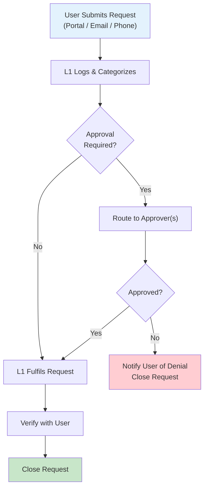

# Service Request Management

> **Nexora Technologies — IT Service Desk**
> Service request fulfilment process for L1 support.

## Incident vs Service Request

This is the most common point of confusion for new analysts.

| | Incident | Service Request |
|---|---|---|
| **What it is** | Something broke or degraded | User wants something provisioned or changed |
| **Trigger** | Unplanned interruption | Planned, standard ask |
| **Example** | "My laptop won't boot" | "I need a new laptop" |
| **Example** | "I can't access the shared drive" | "Please give me access to the Finance share" |
| **Example** | "Outlook is crashing" | "Install Adobe Acrobat on my machine" |
| **Goal** | Restore service ASAP | Fulfil the request per the catalog |
| **SLA clock** | Starts on detection | Starts on submission |

**Rule of thumb:** If the user had working service and it stopped working → incident. If the user is asking for something they don't currently have → service request.

**Edge cases:**
- "I forgot my password" → Service Request (password reset is a standard fulfilment action, nothing is broken)
- "My account is locked out" → Incident (something unexpected interrupted their access)
- "Install Teams" → Service Request
- "Teams won't launch" → Incident

## Nexora Technologies Service Request Catalog

### Category: Account Management

| Request Type | Description | Approval Required | Typical Fulfilment Time | Fulfilment Team |
|---|---|---|---|---|
| New User Account | AD account, email, standard group memberships | Manager approval | 4 hours | L1-Access |
| Account Deactivation | Offboarding — disable AD, revoke access, mailbox conversion | HR confirmation | 2 hours | L1-Access |
| Password Reset | Reset AD/email password, verify identity first | None (identity verified) | 15 minutes | L1-Desktop |
| Account Unlock | Unlock after lockout policy triggered | None (identity verified) | 15 minutes | L1-Desktop |
| Distribution List Change | Add/remove members from a DL | DL owner approval | 1 business day | L1-Access |

### Category: Software

| Request Type | Description | Approval Required | Typical Fulfilment Time | Fulfilment Team |
|---|---|---|---|---|
| Standard Software Install | From the approved list (Chrome, 7-Zip, Notepad++, etc.) | None | 2 hours | L1-Desktop |
| Licensed Software Install | Requires license allocation (Adobe, Visio, Project) | Manager + IT Manager approval | 1-2 business days | L1-Desktop |
| Software Removal | Uninstall software from user's device | None | 2 hours | L1-Desktop |
| Software Update | Patch or version upgrade for installed software | None (unless major version) | 4 hours | L1-Desktop |

### Category: Hardware

| Request Type | Description | Approval Required | Typical Fulfilment Time | Fulfilment Team |
|---|---|---|---|---|
| New Laptop/Desktop | Provision and configure a new device | Manager + IT Manager approval | 3-5 business days | L1-Desktop |
| Monitor Request | Additional or replacement monitor | Manager approval | 2-3 business days | L1-Desktop |
| Peripheral Request | Keyboard, mouse, headset, webcam, docking station | None (under ₹5,000) / Manager (over ₹5,000) | 1-3 business days | L1-Desktop |
| Hardware Replacement | Replace a defective device | IT Manager approval | 2-5 business days | L1-Desktop |
| Equipment Return | Offboarding or device swap returns | None | 1 business day | L1-Desktop |

### Category: Access & Permissions

| Request Type | Description | Approval Required | Typical Fulfilment Time | Fulfilment Team |
|---|---|---|---|---|
| Shared Drive Access | Grant access to a department file share | Data owner approval | 4 hours | L1-Access |
| Application Access | Grant access to a specific business application | Application owner + Manager | 1 business day | L1-Access |
| VPN Access | Enable VPN profile for remote work | Manager approval | 4 hours | L1-Network |
| Admin Rights (Temporary) | Temporary local admin for a specific task | IT Manager approval | 2 hours, max 24hr grant | L1-Desktop |
| Printer Access | Add user to a printer queue / install driver | None | 1 hour | L1-Desktop |

### Category: Email & Communication

| Request Type | Description | Approval Required | Typical Fulfilment Time | Fulfilment Team |
|---|---|---|---|---|
| Shared Mailbox Setup | Create a new shared mailbox | Manager approval | 1 business day | L1-Access |
| Shared Mailbox Access | Grant access to existing shared mailbox | Mailbox owner approval | 4 hours | L1-Access |
| Email Alias | Add an alias to a user's mailbox | Manager approval | 4 hours | L1-Access |
| Teams Channel Creation | Create a new Teams channel or team | None (standard) / IT Manager (org-wide) | 4 hours | L1-Desktop |

## Request Fulfilment Workflow

## Fulfilment Process — Step by Step

### 1. Receive and Log

- Create a Service Request record (not an incident)
- Capture: who's requesting, what they need, business justification (if applicable)
- Assign the correct request type from the catalog above

### 2. Validate

- Is this request in the service catalog? If not, it might need a change request instead.
- Does the user's role justify the request? (e.g., requesting developer tools for a finance role — check with manager)
- Is there stock available for hardware requests?

### 3. Route for Approval (if required)

- System sends approval request to the designated approver
- Track approval SLA: approvers should respond within 1 business day
- If no response after 2 business days, escalate to the approver's manager
- Document the approval decision in the ticket

### 4. Fulfil

- Follow the standard operating procedure for the request type
- For account provisioning: use the new hire checklist, verify all group memberships
- For software installs: use the approved software list, document the version installed
- For hardware: update the asset register after assignment

### 5. Verify and Close

- Confirm with the user that the request was fulfilled correctly
- Update asset management records if applicable
- Close the request with fulfilment notes

## Standard Operating Procedures

### New User Account Setup

1. Receive approved request with: Full name, department, manager, start date, role
2. Create AD account following naming convention: `firstname.lastname`
3. Set temporary password, enforce change on first login
4. Add to department security group and standard groups (All-Staff, etc.)
5. Create mailbox
6. Add to relevant distribution lists per department
7. Document account details in the ticket (username, groups added)
8. Send welcome email with credentials to the user's manager (not to the user's personal email)

### Password Reset

1. Verify identity: Ask for employee ID and manager's name, or verify through the manager directly
2. Reset password in AD: `Set-ADAccountPassword -Identity username -Reset`
3. Set "User must change password at next logon"
4. Communicate the temporary password securely (in person or phone, never email)
5. Confirm the user can log in

### Software Install (Standard)

1. Verify the software is on the approved list
2. Check the user's machine meets minimum requirements
3. Install via SCCM/Intune push or local install from the software share
4. Verify the application launches correctly
5. Document the version installed and the asset it was installed on

## Metrics

| Metric | Target |
|--------|--------|
| Request fulfilment rate within SLA | ≥95% |
| Approval turnaround time | ≤1 business day |
| User satisfaction with fulfilment | ≥4.0/5.0 |
| Requests requiring rework | ≤3% |

## Common Mistakes

- Logging a service request as an incident (or vice versa)
- Fulfilling a request before getting required approval
- Not updating the asset register after hardware/software provisioning
- Sending credentials via email instead of a secure channel
- Not verifying with the user before closing the request
