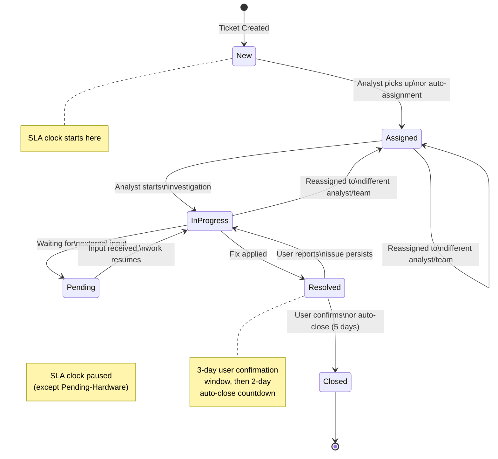

# Ticket Lifecycle

> **Nexora Technologies — IT Service Desk**
> Complete ticket status flow and transition rules.

## Overview

Every ticket in the ITSM system follows a defined lifecycle. Each status has a clear meaning, and transitions between statuses happen under specific conditions. This prevents tickets from sitting in limbo and ensures nothing falls through the cracks.

## Ticket Statuses

| Status | Meaning | Who Owns It |
|--------|---------|-------------|
| **New** | Ticket just created, not yet picked up by anyone | Unassigned (queue) |
| **Assigned** | An analyst has been assigned but hasn't started work | Assigned analyst |
| **In Progress** | Active investigation or resolution underway | Assigned analyst |
| **Pending** | Work paused, waiting for something external | Assigned analyst (monitoring) |
| **Resolved** | Fix applied, waiting for user confirmation | Assigned analyst |
| **Closed** | Issue confirmed resolved, ticket finalized | System / analyst |

### Pending Sub-statuses

| Sub-status | Meaning | SLA Clock |
|------------|---------|-----------|
| **Pending — User** | Waiting for user to provide information, test, or confirm | Paused |
| **Pending — Vendor** | Waiting for third-party vendor action | Paused |
| **Pending — Change** | Resolution requires a change that's awaiting approval/implementation | Paused |
| **Pending — Hardware** | Waiting for replacement hardware to arrive | Running (track in procurement) |

## State Diagram

## Transition Rules

### New → Assigned

| Condition | Detail |
|-----------|--------|
| **Trigger** | Analyst picks the ticket from queue, or auto-assignment rule fires |
| **Required action** | Analyst accepts ownership |
| **SLA impact** | Response SLA clock is ticking — must contact user within response time |
| **Who can do it** | Any L1 analyst, Service Desk Lead, or auto-assignment rule |

**Auto-assignment rules at Nexora:**
- P1 → Assign to on-call analyst immediately + notify Service Desk Lead
- P2 → Assign to first available analyst in the matching L1 group
- P3/P4 → Round-robin within the matching L1 group

### Assigned → In Progress

| Condition | Detail |
|-----------|--------|
| **Trigger** | Analyst starts active work on the ticket |
| **Required action** | Contact the user (satisfies response SLA) and begin diagnosis |
| **SLA impact** | Response SLA satisfied when user is contacted |
| **Mandatory fields** | Initial notes documenting the contact and initial assessment |

The transition from Assigned to In Progress should happen quickly. Don't let tickets sit in Assigned — if you're not going to work on it now, don't pick it up.

### In Progress → Pending

| Condition | Detail |
|-----------|--------|
| **Trigger** | Analyst needs something they can't provide themselves |
| **Required action** | Document what you're waiting for and from whom |
| **SLA impact** | Clock pauses (except Pending-Hardware) |
| **Mandatory fields** | Pending reason, pending sub-status, expected response timeframe |

**Rules for Pending:**
- Set a follow-up date. If no response by that date, follow up proactively.
- Pending-User: If no response after 3 business days, try again. After 5 business days with no response, resolve with note "Unable to verify — user unresponsive" and let the auto-close process handle it.
- Pending-Vendor: Check vendor case status daily for P1/P2, every 2 days for P3/P4.

### Pending → In Progress

| Condition | Detail |
|-----------|--------|
| **Trigger** | The information/action you were waiting for arrives |
| **Required action** | Resume work, document what was received |
| **SLA impact** | Clock resumes |
| **Mandatory fields** | Notes on what was received and next steps |

### In Progress → Resolved

| Condition | Detail |
|-----------|--------|
| **Trigger** | The fix has been applied and the service is restored |
| **Required action** | Document the resolution clearly, notify the user |
| **SLA impact** | Resolution SLA evaluated at this point |
| **Mandatory fields** | Resolution notes, root cause (if known), resolution category |

**Resolution notes must include:**
1. What the problem was (root cause or immediate cause)
2. What you did to fix it (specific steps)
3. How you verified it's working
4. Any follow-up actions needed (e.g., problem record to raise, knowledge article to write)

**Bad resolution note:** "Fixed the issue."
**Good resolution note:** "Outlook crash caused by corrupted OST file. Renamed `outlook.ost` in `%localappdata%\Microsoft\Outlook\`, restarted Outlook to trigger resync. Verified user can open attachments. ~2GB mailbox took 15min to resync. No data loss — OST is a local cache of server data."

### Resolved → Closed

| Condition | Detail |
|-----------|--------|
| **Trigger** | User confirms resolution is satisfactory, OR auto-close timer expires |
| **Required action** | Final review of ticket quality |
| **Closure checklist** | Category correct? Priority correct? Resolution notes complete? Time logged? |

**Auto-close process:**
1. Ticket moves to Resolved → System sends user a confirmation email
2. User has 3 business days to respond "yes it's fixed" or "no, still broken"
3. If user confirms → Close immediately
4. If no response after 3 business days → System sends a reminder
5. If no response after 5 business days total → Auto-close with note "Auto-closed — no user response after 5 business days"

### Resolved → In Progress (Reopen)

| Condition | Detail |
|-----------|--------|
| **Trigger** | User reports the issue is not actually fixed |
| **Required action** | Investigate why the fix didn't hold, document findings |
| **SLA impact** | Resolution SLA restarts from original log time (the ticket is now breaching or at risk) |
| **Maximum reopens** | After 3 reopens, escalate to Service Desk Lead for review |

Reopens are a quality signal. If your tickets reopen frequently, review your verification process.

### In Progress → Assigned (Reassignment)

| Condition | Detail |
|-----------|--------|
| **Trigger** | Ticket needs to be handled by a different analyst or team (functional escalation) |
| **Required action** | Document everything you've tried, update the ticket, notify the receiving team |
| **SLA impact** | Clock continues running — reassignment doesn't reset or pause the SLA |

**Critical rule:** The SLA clock never resets on reassignment. An L2 team inherits whatever time has already elapsed. This is by design — it prevents "ticket ping-pong" where teams bounce tickets to reset the clock.

## Ticket Quality Checklist (Before Closing)

Every ticket should pass this quality check:

- [ ] **Category and subcategory** are accurate (not just the initial assignment)
- [ ] **Priority** was correctly assessed using Impact × Urgency matrix
- [ ] **Description** captures the user's actual report
- [ ] **Resolution notes** are specific and reproducible
- [ ] **Root cause** identified and documented (or noted as unknown)
- [ ] **Time entries** logged accurately
- [ ] **User confirmation** received (or auto-close process followed)
- [ ] **Related records** linked (problem record, change, knowledge article)
- [ ] **Asset** field populated if applicable

## Metrics Derived from Lifecycle

| Metric | How It's Calculated | What It Tells You |
|--------|--------------------|--------------------|
| Average time in New | Mean time from creation to Assigned | Queue backlog / staffing adequacy |
| L1 Resolution Rate (Non-Escalated) | Tickets that went New → Assigned → In Progress → Resolved without reassignment to L2/L3 | L1 effectiveness |
| Reopen rate | % of tickets that went Resolved → In Progress | Fix quality |
| Pending time ratio | Time in Pending / total ticket age | Are we waiting too much on others? |
| Mean Time to Resolve | Time from New to Resolved (minus Pending time) | Actual work efficiency |
| Ticket aging | Tickets open longer than 2× their SLA | Stuck tickets needing attention |

## Anti-Patterns

| Pattern | Problem | Fix |
|---------|---------|-----|
| **Ticket hoarding** | Analyst assigns 10 tickets to themselves, works on 1 | Pick up 2-3 at a time max, leave the rest in queue |
| **Premature close** | Closing without user confirmation | Always wait for confirmation or auto-close timer |
| **Status camping** | Ticket sits in "In Progress" for days with no updates | Add notes daily. If blocked, move to Pending with a reason. |
| **Ping-pong** | Teams reassigning back and forth | Service Desk Lead arbitrates. After 2 bounces, both teams join a call. |
| **Ghost pending** | Pending without a follow-up date or reminder | Always set a follow-up date. Review Pending tickets daily. |
| **Priority inflation** | Everything is P1/P2 | Use the matrix. Service Desk Lead reviews priority overrides weekly. |
