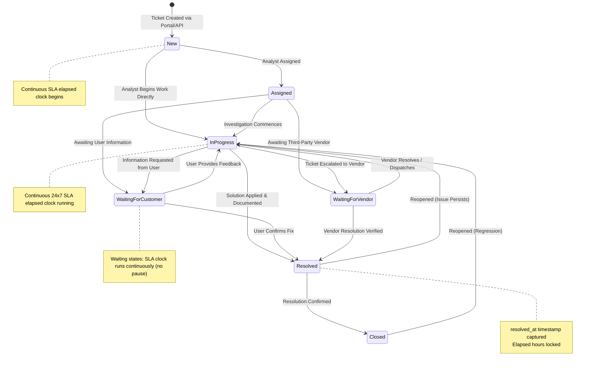

# Ticket Lifecycle & State Machine

> **Nexora Technologies — IT Service Desk**
> Operational ticket status flow, state transitions, and continuous SLA clock rules.

## Overview

Every ticket in the Nexora Service Desk application (`itsm/portal/app.py`) follows a strictly enforced 7-state lifecycle state machine. Transitions are validated on the backend via `ALLOWED_TRANSITIONS`; any illegal jump (e.g., attempting to transition directly from `New` to `Closed`) is rejected with an HTTP 400 response.

## Valid Ticket States

The application defines seven operational states:

| Status | Meaning | Operational Ownership |
|--------|---------|-----------------------|
| **New** | Ticket created via portal or API; triaged and awaiting analyst pickup | Unassigned Queue |
| **Assigned** | Analyst or assignment group assigned; initial response pending | Assigned Analyst |
| **In Progress** | Active diagnostic investigation or technical remediation underway | Assigned Analyst |
| **Waiting for Customer** | Work paused awaiting caller feedback, testing, or supplemental information | Assigned Analyst (monitoring) |
| **Waiting for Vendor** | Work paused awaiting external hardware/software vendor replacement or dispatch | Assigned Analyst (monitoring) |
| **Resolved** | Remediation applied; resolution notes and root cause documented | Assigned Analyst / User |
| **Closed** | Final operational state; user confirmation received or retention finalized | System / Service Desk Lead |

## State Transition Diagram



## Backend Transition Enforcement (`ALLOWED_TRANSITIONS`)

The state machine is implemented in `itsm/portal/app.py` via the following rule dictionary:

```python
ALLOWED_TRANSITIONS = {
    "New": ["Assigned", "In Progress"],
    "Assigned": ["In Progress", "Waiting for Customer", "Waiting for Vendor"],
    "In Progress": ["Waiting for Customer", "Waiting for Vendor", "Resolved"],
    "Waiting for Customer": ["In Progress", "Resolved"],
    "Waiting for Vendor": ["In Progress", "Resolved"],
    "Resolved": ["Closed", "In Progress"],
    "Closed": ["In Progress"]  # Reopening resets resolution timestamp
}
```

### Transition Rules & Operational Triggers

#### 1. New → Assigned or In Progress
- **Trigger:** An L1 analyst claims the ticket from the unassigned queue, or the Service Desk Lead assigns it to a technician.
- **Required Action:** Technician validates priority and contacts the caller if urgent clarification is required.
- **SLA Clock:** Runs continuously from `created_at`.

#### 2. Assigned → In Progress, Waiting for Customer, or Waiting for Vendor
- **Trigger:** Active investigation begins, or initial triage reveals missing user details or external dependency.
- **Required Action:** Analyst logs initial diagnostic note.

#### 3. In Progress → Waiting for Customer or Waiting for Vendor
- **Trigger:** The analyst requires additional log files, physical device access, or vendor dispatch (e.g., ISP circuit outage, Dell hardware replacement).
- **Required Action:** Analyst records a customer comment explaining the needed information, or logs a work note tracking the vendor case number.
- **SLA Policy:** In this operational environment, the SLA clock measures total continuous elapsed hours; waiting states do not halt or pause the 24x7 resolution clock.

#### 4. Waiting for Customer / Vendor → In Progress or Resolved
- **Trigger:** Customer replies via the portal comment interface, or vendor completes field replacement.
- **Required Action:** Analyst resumes diagnostic work (`In Progress`) or moves directly to `Resolved` if the fix is verified.

#### 5. In Progress / Waiting → Resolved
- **Trigger:** Root cause identified, technical fix applied, and service confirmed restored.
- **Mandatory Requirements:** Technician must supply verified `resolution_notes`. Empty or placeholder notes are rejected by the API.
- **SLA Impact:** The backend captures `resolved_at = datetime.now(timezone.utc)` and locks total elapsed hours against the SLA target.

#### 6. Resolved → Closed
- **Trigger:** Customer confirms issue is resolved, or ticket reaches closure review.
- **Outcome:** Ticket reaches terminal lifecycle state.

#### 7. Reopening (Resolved or Closed → In Progress)
- **Allowed Reopen Target:** Reopened tickets transition exclusively to `In Progress`.
- **Clock Mechanics:**
  - The backend resets `resolved_at = NULL`.
  - Elapsed hours resume accumulating from the original creation timestamp (`created_at`).
  - If total elapsed hours exceed the target threshold, the ticket status changes to `Breached` (`sla_breached = 1`).
  - Reopening never resets elapsed time to zero.

## SLA Clock Mechanics & Continuous Time Tracking

Resolution targets are strictly enforced based on priority:
- **P1 (Critical):** 4.0 continuous elapsed hours
- **P2 (High):** 8.0 continuous elapsed hours
- **P3 (Medium):** 72.0 continuous elapsed hours
- **P4 (Low):** 120.0 continuous elapsed hours

$$\text{Elapsed Hours} = \frac{\text{Timestamp}_{\text{resolved}} - \text{Timestamp}_{\text{created}}}{3600}$$

$$\text{Remaining Hours} = \max\left(0.0, \text{Target Hours} - \text{Elapsed Hours}\right)$$

If $\text{Elapsed Hours} > \text{Target Hours}$, the ticket is permanently recorded as breached.

## Operational Queue Mapping

The service desk web console (`/agent`) provides filtered queue visibility corresponding directly to ticket states and SLA risk:

| Queue Filter | Target Query Condition | Operational Purpose |
|--------------|------------------------|---------------------|
| `all` | All tickets | Overall backlog management |
| `unassigned` | `status = 'New' AND assigned_to IS NULL` | Triage and dispatch queue |
| `assigned_me` | `assigned_to = :username` | Personal analyst workload |
| `p1` | `priority = 'P1' AND status NOT IN ('Resolved', 'Closed')` | Critical enterprise incidents |
| `p2` | `priority = 'P2' AND status NOT IN ('Resolved', 'Closed')` | High priority incidents |
| `wait_customer` | `status = 'Waiting for Customer'` | User follow-up tracking |
| `wait_vendor` | `status = 'Waiting for Vendor'` | External supplier management |
| `sla_risk` | `sla_breached = 0 AND remaining_hours <= 2.0` | Active escalation warning queue |
| `sla_breached` | `sla_breached = 1 AND status NOT IN ('Resolved', 'Closed')` | Post-breach management |
| `resolved` | `status IN ('Resolved', 'Closed')` | Verification and reporting |
